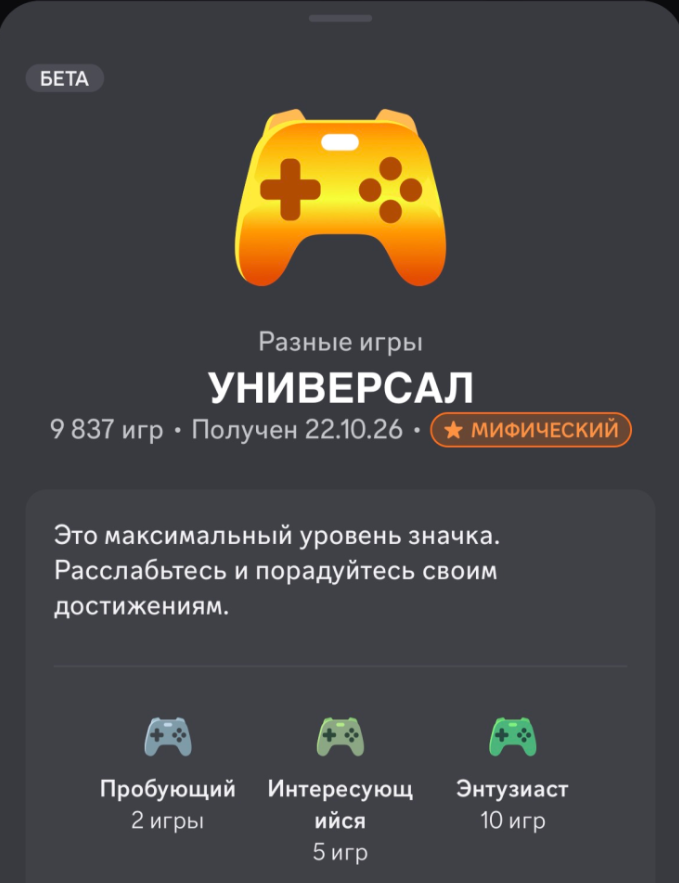

# mimic

**English** · [Русский](README.md)

<div align="center">
  
  <p><strong>Lightweight desktop Discord game activity spoofer & badge booster</strong></p>
  <p>Boost your Discord profile <b>Game Variety (Универсал)</b> and <b>Game Time (Время в играх)</b> badges natively on Windows & Linux.</p>
  <br />
  
  <p><sub>Mythic «Универсал» badge unlocked with 9,837 games via mimic</sub></p>
</div>

---

<a id="download"></a>

## ⬇️ Download (no terminal needed)

**👉 [Download the latest release](https://github.com/Timon2306/mimic-discord/releases/latest)** and open the **Assets** section at the bottom of the page.

| Your system | File to download |
| --- | --- |
| Windows (easiest) | `mimic_<version>_x64_portable.exe` — download and run, no installation |
| Windows (installer) | `mimic_<version>_x64-setup.exe` — installs with a Start Menu and desktop shortcut |
| Linux | `mimic_<version>_amd64.AppImage` (`chmod +x` and run) or `mimic_<version>_amd64.deb` |

- **Do not** download `Source code (zip)` — that is the source code, not the app.
- You do **not** need Node.js, Rust or any commands. Those are only for developers (see [Building from source](#build)).
- Start the **Discord desktop app** before mimic (the browser version does not work).
- If Windows shows "Windows protected your PC", click **More info → Run anyway**. The app is not code-signed, which is why SmartScreen warns about it.
- **Do not run mimic while playing games with anti-cheat** (Rust, Valorant, Fortnite, Apex, CS2, etc.). mimic does not touch games, but it is better not to keep it open next to an anti-cheat. Close the game first, then start mimic.

---

## ✨ Features

- **🏆 Game Variety Badge Booster**: Rapidly cycles through verified Discord titles in parallel batches (e.g. 8 games with 15s hold). Tested and proven to unlock the Mythic **Универсал** badge (9,800+ games).
- **⏱️ Game Time Multiplier**: Running multiple games concurrently multiplies your Discord gameplay tracking hours (e.g. 8 games × 5 hours = 40 hours credited).
- **🐧 Multiplatform Support**: Runs natively on both **Windows** (Win32 dummy process window emulation) and **Linux** (`prctl`/`/proc/self/comm` emulation). Note: Discord's database is heavily Windows-oriented — on Linux only **8** games have a native executable, see [Known Limitations](#limitations).
- **🛡️ 100% Safe & Native**: Zero token extraction, zero memory injection, zero Discord client modifications. Discord naturally detects running games via official OS process inspection APIs.
- **⚡ Background Process Emulation**: Lightweight dummy engine creating legitimate application processes without stealing focus or interrupting your work.
- **🧹 Zero Residual Disk Footprint**: Instant per-batch cleanup ensuring temporary files are immediately removed from disk, preventing Discord settings cache bloat.
- **💾 Smart History & State**: Persistent cache (`history.json`) skips already spoofed games across sessions so you never repeat entries.

---

## 🎮 How It Works

Discord tracks two badges for desktop gamers:

1. **Game Variety (Разные игры — Универсал)**:
   - Tracks unique PC titles played over time.
   - Cycles through Discord's official database of 10,000+ detectable applications.
   - Recommended setting: **Batch Size: 8**, **Hold Duration: 15s**.
   - *Note: Discord servers process badge telemetry in batch intervals (up to 24h delay).*

2. **Game Time (Время в играх)**:
   - Tracks total playtime hours.
   - Running parallel dummy processes multiplies tracked hours (e.g. 8x boost).
   - Use the **Hour farm** tab: pick up to 20 games and they keep running without rotating until you stop them or the timer ends.

---

## 🛠️ Tech Stack

- **Backend**: Rust, [Tauri v2](https://v2.tauri.app/), Tokio, Reqwest, Windows API (`windows-sys`), Linux (`libc`)
- **Frontend**: React, TypeScript, Vite, Tailwind CSS

---

<a id="build"></a>

## 🧑‍💻 Building from source

> Only for developers. If you just want to use the app, [download it](#download) instead.

### Prerequisites

- [Node.js](https://nodejs.org/) (v18+)
- [Rust](https://rustup.rs/) (v1.75+)
- [Discord Desktop Client](https://discord.com/)

### Installation & Run

```bash
# Clone the repository
git clone https://github.com/Timon2306/mimic-discord.git
cd mimic-discord

# Install dependencies
npm install

# Run in development mode
npm run tauri dev
```

### Production Build

```bash
# Build standalone installer & executable
npm run tauri build
```

Compiled standalone binaries:
- Windows: `src-tauri/target/release/bundle/nsis/` & `src-tauri/target/release/mimic.exe`
- Linux: `src-tauri/target/release/bundle/appimage/` & `src-tauri/target/release/bundle/deb/`

### Release assets

Every release ships four files:

| Platform | File | Notes |
| --- | --- | --- |
| Windows | `mimic_<version>_x64-setup.exe` | NSIS installer (Start Menu + desktop shortcut) |
| Windows | `mimic_<version>_x64_portable.exe` | Single portable exe — download and run, no installation |
| Linux | `mimic_<version>_amd64.AppImage` | Portable, `chmod +x` and run |
| Linux | `mimic_<version>_amd64.deb` | Debian/Ubuntu package |

The portable Windows build is the very same binary as the installed one — it just is not wrapped in an installer. It still needs the WebView2 runtime, which ships with Windows 10/11 by default.

---

<a id="limitations"></a>

## ⚠️ Disclaimer & Known Limitations

- **Badge results are not guaranteed.** Discord decides what counts, so going past the verified numbers below may not progress the badge any further.
- **Tested on Windows only**, with Discord games tracked up to **~10,000 games in the badge** (Mythic «Универсал»).
- **Linux: native mode covers only 8 games.** Discord's public detectable database contains just eight Linux executables — Hearts of Iron IV, Factorio, Throne of Lies, VA-11 HALL-A, Fields of Mistria, CS:GO, Move or Die and Terraria — so process-based spoofing cannot go past them. Wine/Proton does not help: those Windows titles exist only as `win32` entries, and the Linux Discord client does not match their processes. The remaining ~24,900 titles are available only through the beta Discord RPC mode, which Discord may not credit to your profile at all.
- A target of **24,000 games is unverified** — it may work, may be throttled, or may have no effect at all.
- **Do not run mimic at the same time as games with anti-cheat** (EAC, BattlEye, Vanguard, VAC, etc.). mimic never injects into games or reads their memory, but it does start processes named after games, and we cannot guarantee how an anti-cheat will react to that.
- Game activity spoofing is not officially supported by Discord. Use it at your own risk.

---

## 📄 License

This project is licensed under the [MIT License](LICENSE).
