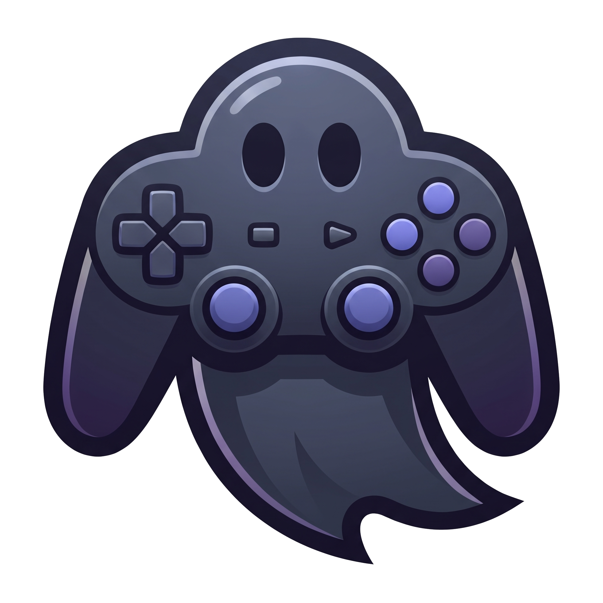
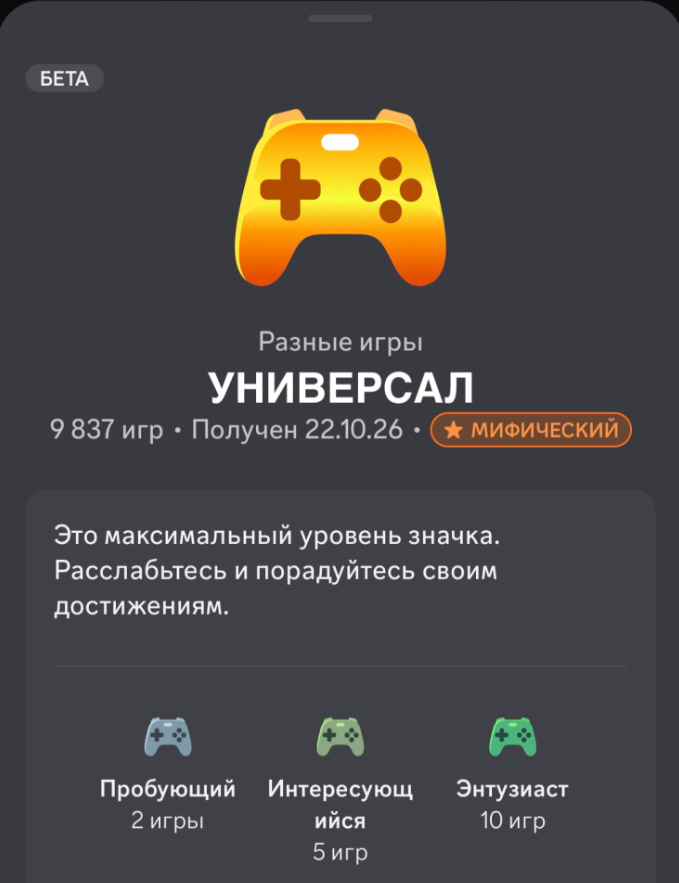

# mimic

[English](README.en.md) · **Русский**

<div align="center">
  
  <p><strong>Лёгкое десктопное приложение для эмуляции игровой активности в Discord и прокачки значков</strong></p>
  <p>Прокачивает значки профиля Discord <b>«Универсал» (Game Variety)</b> и <b>«Время в играх» (Game Time)</b> на Windows и Linux.</p>
  <br />
  
  <p><sub>Мифический значок «Универсал», полученный с mimic на 9 837 играх</sub></p>
</div>

---

<a id="download"></a>

## ⬇️ Что скачать (терминал не нужен)

**👉 [Скачать последнюю версию](https://github.com/Timon2306/mimic-discord/releases/latest)**, затем внизу страницы откройте раздел **Assets**.

| Ваша система | Какой файл скачать |
| --- | --- |
| Windows (проще всего) | `mimic_<версия>_x64_portable.exe`: скачал и запустил, установка не нужна |
| Windows (установщик) | `mimic_<версия>_x64-setup.exe`: ставит ярлыки в меню «Пуск» и на рабочий стол |
| Linux | `mimic_<версия>_amd64.AppImage` (`chmod +x` и запустить) или `mimic_<версия>_amd64.deb` |

- **Не качайте** `Source code (zip)`: это исходный код, а не программа.
- **Не нужны** Node.js, Rust и никакие команды в терминале. Это только для разработчиков (см. [Сборка из исходников](#build)).
- Перед mimic запустите **приложение Discord для ПК** (браузерная версия не подойдёт).
- Если Windows пишет «Система Windows защитила ваш компьютер», нажмите **Подробнее → Выполнить в любом случае**. Программа не подписана сертификатом, поэтому SmartScreen её предупреждает.
- **Не запускайте mimic, пока играете в игры с античитом** (Rust, Valorant, Fortnite, Apex, CS2 и т.п.). mimic не трогает игры, но лучше не держать его открытым рядом с античитом. Сначала закройте игру, потом запускайте mimic.
- Если после mimic зависает вкладка «Зарегистрированные игры» в Discord, см. [как это исправить](#registered-games).

---

## ✨ Возможности

- **🏆 Прокачка «Универсала»**: быстро перебирает проверенные игры из базы Discord параллельными батчами (например, по 8 игр на 15 секунд). Проверено: мифический значок **«Универсал»** открывается (9 800+ игр).
- **⏱️ Умножение «Времени в играх»**: несколько игр, запущенных одновременно, умножают часы в Discord (например, 8 игр × 5 часов = 40 часов).
- **⏳ Фарм часов**: отдельная вкладка, где выбранные игры (до 20) работают вместе и не меняются, пока вы их не остановите или не выйдет таймер.
- **🐧 Windows и Linux**: на **Windows** создаются фоновые окна-пустышки Win32, на **Linux** меняется имя процесса (`prctl`/`/proc/self/comm`). База Discord почти целиком под Windows: на Linux нативный файл есть только у **8** игр, см. [Ограничения](#limitations).
- **🛡️ Безопасно и без модификаций**: токен не нужен, ничего не внедряется в память, клиент Discord не меняется. Discord сам видит запущенные игры через стандартный список процессов ОС.
- **⚡ Работает в фоне**: процессы-пустышки не перехватывают фокус и не мешают работать.
- **🧹 Не мусорит на диске**: временные файлы удаляются сразу после каждого батча.
- **💾 История запусков**: файл `history.json` помнит, какие игры уже были, и пропускает их в следующих сессиях.

---

## 🎮 Как это работает

Discord считает два значка за игры на ПК:

1. **«Универсал» (Game Variety)**:
   - Считает, сколько разных игр на ПК вы запускали.
   - mimic перебирает официальную базу Discord из 10 000+ распознаваемых игр.
   - Рекомендуемые настройки: **8 параллельных процессов**, **15 секунд** удержания.
   - *Discord обновляет значки не сразу, задержка бывает до 24 часов.*

2. **«Время в играх» (Game Time)**:
   - Считает общее количество часов в играх.
   - Параллельные процессы умножают часы (например, в 8 раз).
   - Используйте вкладку **«Фарм часов»**: выберите до 20 игр, и они будут работать без смены, пока вы их не остановите или не выйдет таймер.

---

## 🛠️ Технологии

- **Бэкенд**: Rust, [Tauri v2](https://v2.tauri.app/), Tokio, Reqwest, Windows API (`windows-sys`), Linux (`libc`)
- **Фронтенд**: React, TypeScript, Vite, Tailwind CSS

---

<a id="build"></a>

## 🧑‍💻 Сборка из исходников

> Только для разработчиков. Если нужно просто пользоваться программой, [скачайте готовую версию](#download).

### Что понадобится

- [Node.js](https://nodejs.org/) (v18+)
- [Rust](https://rustup.rs/) (v1.75+)
- [Discord для ПК](https://discord.com/)

### Установка и запуск

```bash
# Скачать репозиторий
git clone https://github.com/Timon2306/mimic-discord.git
cd mimic-discord

# Установить зависимости
npm install

# Запустить в режиме разработки
npm run tauri dev
```

### Сборка релиза

```bash
# Собрать установщик и exe
npm run tauri build
```

Готовые файлы:
- Windows: `src-tauri/target/release/bundle/nsis/` и `src-tauri/target/release/mimic.exe`
- Linux: `src-tauri/target/release/bundle/appimage/` и `src-tauri/target/release/bundle/deb/`

### Файлы в релизе

В каждом релизе четыре файла:

| Система | Файл | Описание |
| --- | --- | --- |
| Windows | `mimic_<версия>_x64-setup.exe` | Установщик NSIS (ярлыки в «Пуске» и на рабочем столе) |
| Windows | `mimic_<версия>_x64_portable.exe` | Один exe без установки: скачал и запустил |
| Linux | `mimic_<версия>_amd64.AppImage` | Без установки: `chmod +x` и запустить |
| Linux | `mimic_<версия>_amd64.deb` | Пакет для Debian/Ubuntu |

Portable-версия для Windows — это тот же exe, что ставит установщик, просто без установщика. Ей нужен WebView2, он уже есть в Windows 10/11.

---

<a id="registered-games"></a>

## 🧊 Зависает вкладка «Зарегистрированные игры»

Discord запоминает каждую игру, которую увидел, и хранит этот список у вас на ПК. После mimic в нём тысячи игр, и вкладка **Настройки → Зарегистрированные игры** пытается показать их все сразу, поэтому зависает. На телефоне такой вкладки нет, поэтому там всё открывается.

Как очистить список:

1. Полностью закройте Discord (в трее тоже нажмите **«Выйти из Discord»**).
2. Нажмите **Win + R**, вставьте `%APPDATA%\discord` и нажмите **Enter**.
3. Удалите папку `Local Storage`.
4. Запустите Discord и войдите в аккаунт заново.

Сбросятся только локальные настройки клиента, и придётся заново войти (с 2FA, если она включена). Сервера, сообщения, значки и часы в играх хранятся на серверах Discord и никуда не денутся.

---

<a id="limitations"></a>

## ⚠️ Предупреждение и ограничения

- **Результат не гарантирован.** Что засчитывать, решает Discord, поэтому выше проверенных чисел значок может не расти.
- **Проверено только на Windows**, до **~10 000 игр в значке** (мифический «Универсал»).
- **Linux: нативный режим работает только с 8 играми.** В публичной базе Discord всего восемь игр с файлом для Linux: Hearts of Iron IV, Factorio, Throne of Lies, VA-11 HALL-A, Fields of Mistria, CS:GO, Move or Die и Terraria. Wine/Proton не помогает: остальные игры есть в базе только как `win32`, и Discord для Linux их процессы не распознаёт. Остальные ~24 900 игр доступны только через бета-режим Discord RPC, который Discord может вообще не засчитать.
- Цель в **24 000 игр не проверена**: может сработать, может упереться в ограничения, а может ни на что не повлиять.
- **Не запускайте mimic одновременно с играми с античитом** (EAC, BattlEye, Vanguard, VAC и т.п.). mimic не внедряется в игры и не читает их память, но он запускает процессы с именами игр, и мы не можем гарантировать, как на это отреагирует античит.
- Discord официально не поддерживает эмуляцию игровой активности. Используйте на свой риск.

---

## 📄 Лицензия

Проект распространяется по [лицензии MIT](LICENSE).
